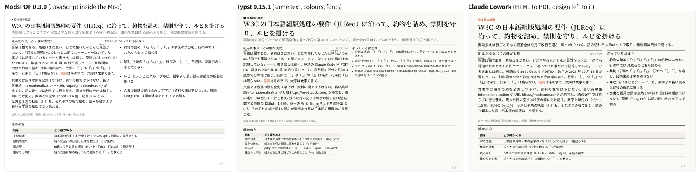
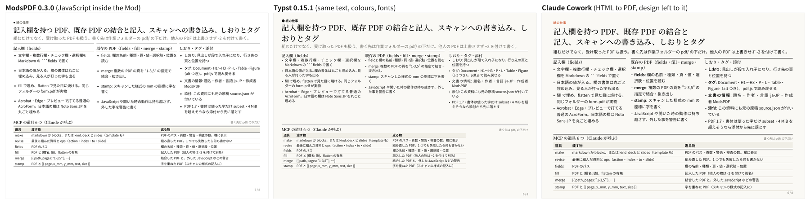

# ModsPDF

A Claude Code Mod that typesets Japanese and English PDFs entirely inside the Mod sandbox. No Typst, no LaTeX, no headless browser: pure JavaScript, with the fonts bundled.

**Status: frozen (2026-10-18).** It works, and all 3,324 unit tests pass. But when I put it side by side with Typst and Claude Cowork on the same material, it did not win. The comparison is below, because it is the most useful thing in this repository.

## It lost to Typst and Cowork

I built the same documents three ways with the same model:

1. **ModsPDF** fed with a JSON deck description.
2. **Typst 0.15.1**, written by hand in `.typ`.
3. **Claude Cowork**, given the same brief and left to choose the design. It renders HTML to PDF with Chromium.

**An eight-page showcase** (the features of this Mod, landscape A4). ModsPDF and Typst came out roughly equal. Cowork was also good, with a freer layout.




**A one-page USD/JPY report** from a bank's daily FX note, with the design left to each side. Each run was timed.

| | Time | Source | Result |
|---|---|---|---|
| Cowork | not measured | brief only | best: most information, best hierarchy |
| Typst | about 11 min | 256 lines of `.typ` | second: dense and clean |
| ModsPDF | about 10 min | 248 lines of JSON | third: readable, but carried the least information |

(The report itself is not included, because its content comes from a third party's note.)

Why ModsPDF lost:

- **Fixed vocabulary.** A deck is 12 layouts, panels and 56 chart shapes. Typst and HTML can draw anything; ModsPDF can only arrange what it already has.
- **Its own safety rails cost density.** To keep text readable, deck body text stays at 11 pt or larger and other text at 10 pt or larger. A dense one-page report needs smaller type.
- **Same effort, less freedom.** Writing the JSON took as long as writing Typst, and Typst could go further.

What still holds:

- It runs inside a Mod with nothing installed: no external binaries, works offline, fonts in the repo.
- Japanese typesetting follows JLReq: punctuation squeezing, kinsoku, ruby, Knuth-Plass line breaking, BudouX phrase breaks.
- A strict test suite and a built-in checker for overlaps, overflow, truncation and sparse pages.

If you need a good PDF from Claude today, use Typst or Cowork. Read this code if you want to see how far a Mod can go on its own.

## What it does

- **Documents** from Markdown or blocks: headings, paragraphs, lists, tables, ruby `{漢字|かんじ}`, charts, form fields.
- **Decks** (`kind: 'deck'`): landscape A4 or 16:9, 12 layouts including a dense `grid` of panels. A business-plan template (`template: 'bizplan'`) builds five pages from structured data.
- **56 chart shapes** (`{ kind, data }`): candle, sankey, treemap, ridgeline, gantt, matrix2x2 and more, plus ECharts options.
- **Existing PDFs**: list and fill form fields, merge and extract pages, stamp text onto scanned forms.
- **Attachments and structure**: the source JSON, notes and dataset CSVs travel inside the PDF; tags and bookmarks are written.
- **Preview**: the typeset pages appear as SVG in a pane next to the conversation.

Tools exposed to Claude: `make`, `revise`, `fields`, `fill`, `merge`, `stamp`, `pdf_examples`. Output goes only under `pdf/` in the working folder. The full reference (Japanese) is in [docs/reference.ja.md](docs/reference.ja.md).

## Install

Claude Code with Mods support is required.

```
/plugin marketplace add nakadaharuki/mods-pdf
/plugin install mods-pdf@mods-pdf
```

Then `/pdf sample` writes a sample document and opens the pane. `/pdf sample deck` builds a fictional business plan.

## Develop

```
npm ci
npm run test:unit        # 3,324 tests
npm run validate         # claude plugin validate --strict .
node scripts/deck-preview.mjs   # samples to out/deck/ as PDF and PNG (needs pdftoppm)
```

`npm run compare` typesets the same text in Typst and counts line-end drift and kinsoku breaks. Point `MODS_PDF_TYPST_FONTS` at folders with the fonts Typst should use (separated by `;` on Windows, `:` elsewhere). Tests that need Typst are skipped when it or the fonts are missing.

Design notes (Japanese): [docs/design.md](docs/design.md), [docs/deck.md](docs/deck.md), [docs/looks.md](docs/looks.md).

## License

MIT, see [LICENSE](LICENSE). Bundled third-party code (pdf-lib, fontkit, ECharts, d3, BudouX, marked and others) and the Noto Sans JP / Noto Serif JP fonts keep their own licenses, listed in [LICENSES/README.md](LICENSES/README.md).

This is frozen: issues and pull requests will not be answered. Fork freely.
